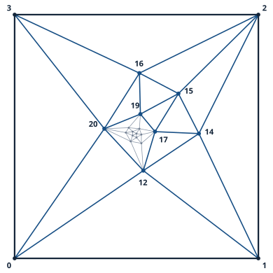

# A counterexample to the diamond-generation conjecture

**An order-21 graph in the authors’ own census refutes Conjecture 30** in
Zdeněk Dvořák, Bernard Lidický, and Bojan Mohar, *On a conjecture concerning
4-coloring of graphs with one crossing*,
[arXiv:2504.08327v2, §2](https://arxiv.org/html/2504.08327v2#Thmtheorem30).
The conjecture says every bichromatic-forbidding 4-candidate is obtained from
the diamond by the operations in Lemmas 27–29. It appears in the full
preprint, not the EUROCOMB’25 extended abstract. This result concerns
Conjecture 30 only; the main one-crossing coloring conjecture (Conjecture 2)
is unaffected. The operations are applied to the whole graph, with the designated outer face, as in the three lemmas.

## The disk

Take line 56 of the authors’ [public census log](https://lidicky.name/pub/mindeg5/bernard25.log):
short graph6 `Tl?GWCJ@oB?Jp?AIK?P?@K?C?JoWEG?WySUH`.
The [explicit plane data](witnesses/conjecture30-census-21.json) give its
56 edges, 36 oriented triangles, and outer cycle `0–1–2–3–0`.



The dark edges are used in the coloring proof below. The drawing uses the
[certificate’s integer coordinates](src/verify_census21.py); the other ten
vertices are unlabeled for legibility.

The face list contains exactly the graph’s 3-cycles. Each interior edge is
used twice in opposite directions and each rim edge once; vertex links are
cycles inside and paths on the rim. Thus the lists specify a connected
surface with one boundary component and Euler characteristic
`21 - 56 + 36 = 1`, hence a disk. All interior degrees are at least five.
The independent checker verifies these facts from the face and edge lists;
the Lean certificate also checks the finite data for the straight-line
embedding. In particular, this is a 4-candidate in the paper’s sense.

## No alternating boundary coloring

Suppose the rim has colors `0, 1, 0, 1` in order. Vertex 12 sees vertices
0 and 1; swap colors 2 and 3 if necessary to give it color 2. Now read down
the table. A vertex seeing three colors is forced to take the fourth.

| Vertex | Already colored neighbors | Color |
|---:|---|---:|
| 14 | 1, 2, 12 | 3 |
| 20 | 0, 3, 12 | 3 |
| 16 | 2, 3, 20 | 2 |
| 15 | 2, 14, 16 | 1 |
| 17 | 12, 14, 15 | 0 |
| 19 | 15, 16, 17, 20 | none |

Vertex 19 sees all four colors, a contradiction. Thus the disk forbids the
bichromatic boundary type. It admits a rainbow boundary coloring.

## No sequence from the diamond

The four-vertex diamond has a chord on its outer cycle.
[Lemmas 28](https://arxiv.org/html/2504.08327v2#Thmtheorem28) and
[29](https://arxiv.org/html/2504.08327v2#Thmtheorem29) require an induced
outer cycle, so the only first move is [Lemma 27](https://arxiv.org/html/2504.08327v2#Thmtheorem27),
which adds 12 vertices and reaches order 16. Every subsequent move adds
3, 4, or 12 vertices. No single move adds the missing five, and two or more
add at least six. Therefore order 21 is unreachable.

## Reproduce

From this directory, using Python 3.10+ and the Lean version pinned in the project:

```sh
python3 src/verify_census21.py witnesses/conjecture30-census-21.json
python3 -m unittest discover -s src/referee -v
python3 src/referee/verify.py --forbidding witnesses/conjecture30-*.json
(cd lean && lake clean && lake build)
```

The [Lean report](RESULTS_lean_certificate.md) explains the checked statements
and the two short bridges to the preprint’s conventions. See also the
[independent referee](RESULTS_independent_referee.md),
[publication and census audit](RESULTS_publication_audit.md), and
[optional 25- and 37-vertex constructions](RESULTS_alternating_patches.md).
The proof and certificates come from [the merged work in Open Math Lab](https://github.com/flamexnreal/open_math_lab/pull/2).
